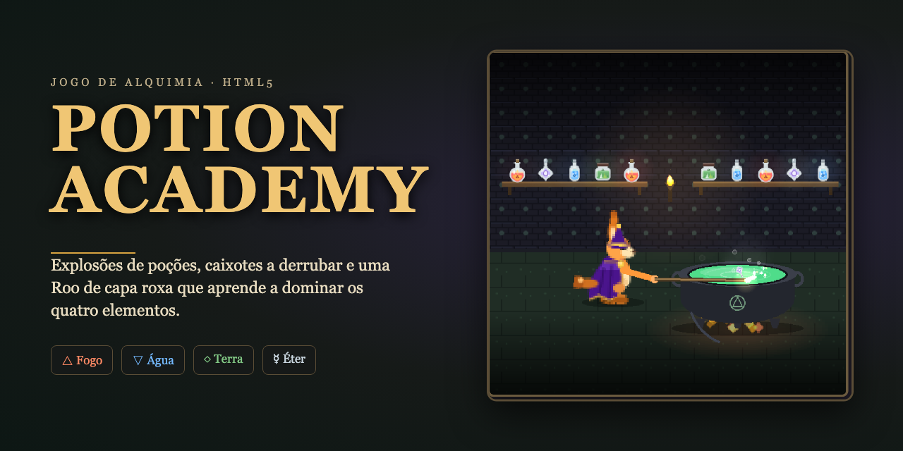
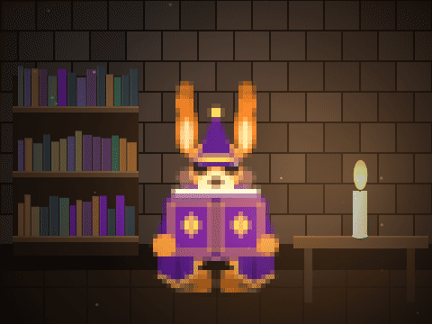

# Potion Academy

<p align="center">
  
</p>

<p align="center">
  <b>Potion Academy</b> é um jogo de alquimia indie desenvolvido para navegador. Jogue com a <b>Roo</b>, uma feiticeira de capa roxa, enquanto ela atravessa quatro fases (o laboratório, o salão dos fantasmas, o duelo com a temível Belladona e o jardim do castelo), lançando poções de quatro elementos e quebrando caixotes.
</p>

<p align="center">
  ✨ <i>Destaque técnico:</i> Tudo é desenhado e sintetizado pelo próprio código — <b>sem imagens bitmap externas ou arquivos de áudio prontos!</b>
</p>

---

<p align="center">
  
</p>

---

## 🎮 Como Jogar

### Pré-requisitos
Certifique-se de ter o [Node.js](https://nodejs.org/) instalado em sua máquina.

### Instalação e Execução
```bash
# Clone o repositório e acesse a pasta
git clone https://github.com/seu-usuario/potion-academy.git
cd potion-academy

# Instale as dependências
npm install

# Inicie o servidor de desenvolvimento
npm run dev

```

Abra `http://localhost:5173` no seu navegador.

### 🕹️ Controles

* **Teclado:** Setas para mover | **Espaço** para colocar poção | **X** para empurrar | **D** para detonar poção etérea | **Enter** para pausar.
* **Mobile / Touch:** O jogo conta com controles de toque automáticos (ou adicione `?touch` na URL).

---

## ✨ Principais Características

* 🔮 **Quatro Elementos que Reagem entre Si:** o fogo acende outras poções, a água apaga as de fogo e a terra é estável. Cada elemento tem explosão e som próprios.
* 🗺️ **Quatro Fases:** sapos magos, fantasmas que atravessam paredes, um duelo com chefe e um jardim com flores do mal que resistem à água.
* 🧙‍♀️ **Chefe com Avisos:** A Belladona lança poções, avisa no chão antes de cada ataque e acelera à medida que perde vida.
* 🎶 **Trilha Sonora Procedural:** 6 faixas geradas em tempo real via WebAudio, uma para cada parte da história, e uma sala para ouvi-las.
* 🎨 **Assets 100% Procedurais:** Sprites gerados em tempo real, sintetizadores de som e tipografia via `@fontsource`.
* 📱 **Design Responsivo:** funciona em celular (em pé e deitado, com controles de toque), tablet, computador e telas grandes, sem rolagem.

---

## 🛠️ Comandos Disponíveis

| Comando | Descrição |
| --- | --- |
| `npm run dev` | Inicia o servidor de desenvolvimento (inclui catálogo em `/sprites.html`) |
| `npm run test` | Executa os testes unitários (Vitest) |
| `npm run typecheck` | Realiza a checagem estricta de tipos com TypeScript |
| `npm run build` | Valida os tipos e gera o build de produção otimizado na pasta `dist/` |

---

## 📂 Estrutura do Projeto

```text
src/
├── main.ts         # Layout, manipuladores do DOM e áudio
├── config.ts       # Balanceamento (tamanho do mapa, vida, poções, elementos)
├── scenes/         # Cenas do Phaser (menu, partida e HUD)
├── game/           # Regras puras (chefe, reação entre poções, recompensas, loja, equilíbrio)
├── textures/       # Geração procedural de sprites (Roo, Belladona, poções, cenário)
├── audio/          # Motor de áudio (WebAudio) e gerador de músicas
└── ui/             # Menus, loja, sala de música e interfaces em DOM
tests/              # Testes unitários
docs/               # Documentação complementar do jogo e do código

```

---

## 📚 Documentação

* [Guia Completo (`docs/`)](docs/README.md): O universo do jogo, glossário, arquitetura e como criar novas mecânicas.
* [Catálogo de Sprites (`docs/09-sprites.md`)](docs/09-sprites.md): Todos os desenhos e fotos categorizadas em `docs/img/sprites/`.
* [Guia de Reutilização (`docs/11-reutilizar.md`)](docs/11-reutilizar.md): Instruções para reutilizar personagens e sistemas em outros projetos.

---

## 📝 Licença

Atualmente sem licença definida. Antes de reutilizar código ou imagens fora deste repositório, por favor, entre em contato com o autor.
