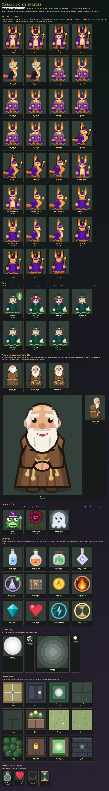

# Sprites

Um sprite é um desenho do jogo (personagem, item, cenário). **Neste projeto nenhum sprite é uma imagem pronta:** todos são desenhados pelo código, com formas simples (círculos, triângulos, retângulos).

## Ver todos os sprites

- **Ao vivo:** com `npm run dev` ligado, abra `http://localhost:5173/sprites.html`. A página gera os mesmos desenhos do jogo, agrupa e rotula. `?zoom=8` amplia mais.
- **Foto geral:** `docs/img/sprites.png`, com todos os grupos.
- **Folha para outros projetos:** o botão *Baixar folha de sprites* gera `potion-academy-sprites.png` e um `.json` com a posição de cada desenho. Veja [11-reutilizar.md](11-reutilizar.md).
- **Fotos por categoria:** `docs/img/sprites/<categoria>.png` (heroes, bosses, humans, enemies, objects, effects, scenery, ui).

Quando mudar um sprite, atualize as fotos: com `npm run dev` ligado, gere de novo a captura de cada seção `section[data-group]` de `/sprites.html` (uma por categoria) e a página inteira para `sprites.png`.

## Regras de todos os sprites

- O tile do mapa tem **40 × 40 px**. Itens, poções, inimigos e cenário cabem em 40 × 40.
- **Roo e Belladona têm 40 × 50 px:** 10 px a mais em cima (`ROO_HEAD_ROOM`) para as orelhas e o chapéu não serem cortados. O ponto de apoio do sprite é o centro do tile; por isso o jogo usa `setOrigin(0.5, rooOriginY(tile))`.
- Os pés ficam a 3 px do fundo da textura.
- O lado direito é o desenho; o esquerdo é o mesmo sprite espelhado (`flipX`).
- Cores com contorno claro nos frascos, escuras nos personagens. Cada elemento tem a sua cor (veja `config.ts`).

## Personagens

**Roo** (`src/textures/roo.ts`)
| Chaves | O que é |
|---|---|
| `roo_down_0-3`, `roo_up_0-3`, `roo_side_0-3` | andando de frente, de costas e de lado (4 quadros cada) |
| `roo_sleep_{down,up,side}_0-1` | dormindo: olhos fechados, cabeça caída, respiração |
| `roo_stir_0-1` | pose do menu: de lado, sem braço e sem varinha (a cena os desenha em movimento) |
| `roo_maestro_0-1` | de casaca e cabelo de Beethoven, batendo a batuta (Sala de Música) |
| `roo_read_0-8` | de frente, lendo: quem olha vê a **capa** do livro (roxa, com losangos dourados) e a Roo vê as páginas. 0 e 8 são parados; de 1 a 7 a mão puxa a folha, que passa por cima do livro (GIF do README) |

O manto é desenhado **depois** do corpo, por isso cobre as costas, os ombros e os braços. A varinha fica ao lado do corpo, nunca sobre o rosto.

**Belladona** (`src/textures/witch.ts`)
| Chaves | O que é |
|---|---|
| `witch_idle_0-1` | parada (o manto e o chapéu balançam) |
| `witch_cast` | lançando poção: braço levantado, boca aberta, brilho verde |
| `witch_hurt` | machucada: olhos fechados em X, boca para baixo |
| `witch_talk_0-1` | falando: a boca abre e fecha (usada quando ela solta uma fala) |
| `witch_defeat` | vencida: olhos fechados em calma, cabeça baixa, poção abaixada. Sem humilhação: ela não gira nem encolhe |

**Frei Anselmo** (`src/textures/anselmo.ts`), monge do mosteiro. Velho gentil: hábito marrom com o capuz abaixado, tonsura com mechas brancas, sobrancelhas e barba brancas, bochechas coradas, cruz de madeira, cordão com nós, mãos juntas, sandálias.

| Chave | Uso |
|---|---|
| `anselmo_front_0-1` | de frente; o 1 sobe a cabeça 1 px (respiração) |
| `anselmo_back` | de costas, capuz caído nas costas |
| `anselmo_side` | perfil, para a direita (sem espelho) |
| `anselmo_retrato` | de frente em 4x (160 x 200), vetorial: carta e cartões de diálogo |

Aparece na carta (retrato), no portão do jardim quando ele se abre (dois quadros de respiração) e na confissão final. As formas são desenhadas só no lado direito e espelhadas, forma por forma, para manter a ordem das camadas.

## Poções (`src/textures/potions.ts`)

| Chave | Elemento | Formato |
|---|---|---|
| `bomb_normal` | fogo | balão de fundo redondo, líquido vermelho com brasas |
| `bomb_mega` | água | tubo alto, líquido azul com onda e gotas |
| `bomb_pierce` | terra | pote largo com cristais verdes |
| `bomb_remote` | éter | frasco em losango com névoa lilás |

## Itens (`src/textures/entities.ts`)

- Power-ups (fichas com aro colorido): `pickup_bomb_up` (lilás), `pickup_fire_up` (laranja), `pickup_speed_up` (ciano), `pickup_time_up` (amarelo).
- Soltos: `pickup_coin`, `pickup_gem`, `pickup_heart`, `pickup_chest`.

## Inimigos (`src/textures/entities.ts`)

- `enemy`: **sapo mago**, da fase 1. Corpo verde com contorno escuro, olhos saltados, chapéu roxo com estrela e um cajado com orbe azul.
- `enemy_ghost`: **fantasma** do salão dos fantasmas: atravessa obstáculos e anda devagar. Meio transparente (fica mais ainda dentro de uma parede), com a barra de baixo ondulada.
- `enemy_flower`: **flor do mal** do jardim: fixa, pétalas escuras (magenta e roxo), olhos vermelhos e dentes. O sprite balança preso ao chão. É imune à Aqua.
- Movimento: cada passo tem um pulo (7 px na vertical, 3 px na horizontal) e, parado, um balanço de 1 px (`animateEnemy` em `MainScene.ts`).

## Efeitos de ser atingido

Quando uma explosão atinge um inimigo ou a Roo, aparece um efeito próprio do elemento (`hitFx` em `MainScene.ts`, tabela `HIT_FX`):

| Elemento | Inimigo | Roo |
|---|---|---|
| fogo | brasas que sobem | tinge de laranja + brasas |
| água | respingos que caem | tinge de azul + gotas |
| terra | lascas de pedra e poeira | tinge de marrom + lascas |
| éter | faíscas que giram no ar | tinge de lilás claro + faíscas |

## Cenário, HUD e efeitos

- Cenário do castelo (`terrain.ts`): `floor1`, `floor2`, `wall`, `block`, `door_closed`, `door_open`. O salão dos fantasmas usa os mesmos desenhos com um tom azulado (`LOOKS` em `MainScene.ts`).
- Cenário do jardim (`garden.ts`): `g_floor1`, `g_floor2` (grama), `g_wall` (sebe), `g_block` (canteiro de flores) e `gate_closed`, `gate_open` (portão).
- HUD (`hud.ts`): `hud_heart`, `hud_heart_empty`, `hud_hourglass`.
- Peças de partículas (`menu.ts`): `menu_spark`, `menu_bubble`, `menu_puff` (usadas no menu, nas explosões, nos brilhos).

## Organização por papel no jogo

As categorias abaixo aparecem agrupadas no catálogo (`src/sprites.ts`) e em `docs/img/sprites/`. Os arquivos de código ainda são separados por tipo técnico (`roo.ts`, `witch.ts`, `entities.ts`); a pasta de código pode seguir a mesma divisão depois:

| Pasta | O que vai dentro | Exemplos atuais |
|---|---|---|
| `heroes/` | a jogadora | Roo |
| `bosses/` | chefes | Belladona (`witch_*`) |
| `enemies/` | inimigos comuns | sapo mago (`enemy`), fantasma (`enemy_ghost`) |
| `objects/` | o que se coleta ou se usa | poções (`bomb_*`), itens (`pickup_*`), caixotes e portas |
| `effects/` | partículas e brilhos | `menu_spark`, `menu_bubble`, `menu_puff`, explosões |
| `scenery/` | o chão e as paredes | `floor1`, `floor2`, `wall`, `block` |
| `ui/` | HUD e menus | `hud_*` |

Regra de nome: `papel_nome[_estado][_quadro]`, por exemplo `enemy_ghost`, `boss_belladona_cast`, `roo_side_2`. Hoje as chaves usam prefixos diferentes (`witch_` para a Belladona, `enemy` sem prefixo); renomear exige trocar as chaves no código, o que é seguro porque as chaves não ficam salvas no navegador.

## Como criar um sprite novo

1. Escolha o arquivo certo em `src/textures/` (ou crie um) e uma **chave** com o padrão `grupo_nome` (ex.: `pickup_chave`).
2. Copie uma função parecida (ex.: o baú) e troque formas e cores. Use `make('chave', (g, T) => { ... })`: `T` vale 40.
3. Se for um personagem, use a altura `rooTextureHeight(T)` (50) e desenhe a partir do chão.
4. Registre a função em `src/textures/index.ts`.
5. Abra `/sprites.html` e confira o desenho ampliado.
6. Coloque o sprite no jogo com `this.add.image(x, y, 'chave')`.
7. Atualize esta tabela e a foto `docs/img/sprites.png`.

Dica: desenhe em camadas, do fundo para a frente (sombra, corpo, roupa, rosto, acessórios). O que é desenhado depois cobre o que veio antes.
