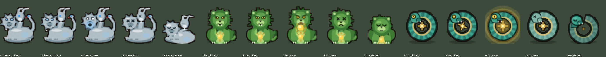

# Proposta: melhorar as animações dos personagens

> **Andamento (2026-11-21).** A proposta foi aprovada e implementada do mais fácil ao mais difícil, **com quadros derivados** dos que já existem (`textures/derive.ts`: squash and stretch em linhas inteiras de pixels, sem suavização), e não com corpos novos desenhados à mão. Isso entrega a antecipação e o impacto com quase nenhum custo de textura; os desenhos feitos à mão (um gesto próprio para cada chefe, por exemplo) continuam possíveis depois, com as mesmas chaves.
>
> | Fase | Feito | Onde |
> |---|---|---|
> | E | Mestre em 4 quadros (lanterna balança, olhos piscam, cristal pulsa); sapo se agacha antes de saltar; lanterna com 3 quadros de chama | `textures/mestre.ts`, `EnemySystem.applyFrame` |
> | C | Poses da Roo: dano, pôr a poção, pegar item, chegar à porta e desabar | `textures/poses.ts`, `MainScene.playPose` |
> | D | Frei Anselmo abençoa quando o portão do jardim abre (braço sobe em 3 quadros, com brilho) | `addAnselmoBless`, `spawnAnselmoAtGate` |
> | A | Transformação: círculo alquímico sob os pés, clarão branco, o elemento estoura; fim da forma com clarão e fumaça; último degrau pisca | `textures/transformFx.ts`, `RooFormSystem.transformBurst` |
> | B | Chefes: preparo do corpo antes de cada golpe (260 ms, em todos), fôlego depois, respiração em 4 quadros, queda em 2 quadros e idle mais rápido na fúria | `BossBase`, `addBossPoses` |
>
> **Adiado:** andar, falar e partir o pão do Anselmo (ainda não há onde mostrar), as expressões do retrato, poses de ataque da Roo transformada (a forma usa o próprio corpo), os quadros de cavar, voar e derreter dos inimigos e o *poof* de morte por elemento. Correção ao inventário abaixo: a Roo parada já respira em dois quadros (`roo_idle_*`, que reaproveita os quadros 0 e 1 do andar).

Documento de **proposta** (a implementação está resumida acima). Escrito em 2026-11-21 a partir do que existe hoje no código e nos sprites. Serve para decidir o que desenhar primeiro, com quantos quadros e quanto isso custa em desempenho.

## 1. O ponto de partida

Os desenhos de cada personagem são bons, mas **quase nada se move de verdade**: a maior parte das animações é troca de pose e efeito de tela. Inventário medido nas texturas geradas:

| Personagem | Quadros hoje | O que existe |
|---|---|---|
| **Roo** | 4 (andar) x 3 direções; 2 (dormir) x 3; 2 (acordar); 9 (lendo, só no menu) | andar a 12 quadros/s; sem pose de ataque, dano, comemoração nem queda |
| **Formas da Roo** | 4 degraus x 3 direções x 4 quadros x tremor (fogo: 8 fases) | o mesmo andar, recolorido e com efeito; geradas só quando a partida começa |
| **Belladona** | 7: `idle` 2, `cast` 1, `hurt` 1, `talk` 2, `defeat` 1 | |
| **Mandrágora** | 15: `idle` 6, `walk` 4, `cast`, `hurt`, `talk` 2 | a única com ciclo de andar |
| **Quimera, Leão Verde, Ouroboros** | 7 cada, como a Belladona | |
| **Frei Anselmo** | 5: `front` 2, `back`, `side`, retrato | sem andar, sem gesto, sem expressão |
| **Mestre em sombra** | 2 | |
| **Inimigos** | 1 a 3 (dois quadros de vida e, às vezes, um de estado) | o passo é um *tween* (pulo e balanço), não desenho |

Fotos dos quadros atuais: [Roo, Anselmo e Mestre](img/animacoes-atuais-roo.png), [chefes 1](img/animacoes-atuais-chefes-a.png) e [chefes 2](img/animacoes-atuais-chefes-b.png).

### O que as fotos e o código mostram
1. **A transformação é instantânea.** `RooFormSystem.startForm` troca o sprite, dá um *flash* de câmera de 200 ms, um texto flutuante e um som. É o momento mais importante do jogo e não tem quadro de transição. O fim da forma também é um corte seco.
2. **Os chefes não anunciam o golpe no próprio corpo.** O aviso é só no chão (`telegraph`). O corpo tem **um** quadro de `cast`, e nos três últimos chefes ele só muda um brilho ou a boca (veja o Ouroboros e a Quimera). Como `idle_0` e `idle_1` quase não diferem, o chefe parece parado a 2 quadros/s.
3. **O Frei Anselmo é uma estátua que respira.** É o personagem de maior peso emocional (carta, portão, confissão, final) e o que tem menos poses.
4. **O dano da Roo e dos inimigos é piscada**, sem quadro de reação desenhado.

## 2. Princípios (para manter o estilo e o desempenho)

- **Pixel art como Super Bomberman 3/5**: escala inteira, sem girar sprites, sem degradê suave. Por isso o que hoje é *tween* de escala (`scaleX 1.2`) vira **quadro desenhado**.
- **Tudo desenhado por código**, com a mesma função por personagem recebendo um parâmetro de fase (como `drawBubbleFront(phase)`), contorno escuro de 1 px (`outlineTexture`) e as mesmas chaves nomeadas (`<prefixo>_<pose>_<n>`).
- **Orçamento de texturas.** Lição do Manuscrito (`docs/06-decisoes.md`): as 16 poses da Roo bebê custavam mais da metade do JavaScript de cada página. Regras: (a) o que só uma tela usa é **opcional** e gerado sob demanda; (b) preferir **efeito sobreposto** a um corpo novo por forma; (c) medir o boot antes e depois (`scripts/` + perfil), com meta de **no máximo +30 ms** no boot do jogo.
- **Reaproveitar o `fxPool`** (`game/fx/particlePool.ts`) para partículas: nada de um emissor por efeito (`docs/21-desempenho.md`).
- **Respeito à fé** (CLAUDE.md): nenhuma cruz em objeto, inimigo ou ficha. O hábito de Anselmo e o mosteiro seguem como as únicas exceções.

## 3. Propostas, por prioridade

### Prioridade 1: a transformação da Roo
O maior ganho por quadro desenhado. Em vez de um corpo novo por forma (os 1.536 quadros já pesam), a sequência usa **o corpo do degrau 4 que já existe** mais **efeitos sobrepostos pequenos** (48 x 48 px).

| Etapa | Duração | Quadros | O que se vê |
|---|---|---|---|
| 1. Agachar | 80 ms | 1 pose nova da Roo (`roo_charge_{dir}`, 3 direções) | Roo se encolhe, varinha para cima |
| 2. Círculo alquímico | 160 ms | 2 efeitos por elemento | o círculo de símbolos acende no chão em volta dos pés (△ ▽ △ com barra ▽ com barra) |
| 3. Silhueta branca | 1 quadro (60 ms) | 0 novos (tinta branca no corpo atual) | a Roo vira um clarão com a forma da nova |
| 4. Explosão da forma | 200 ms | 2 efeitos por elemento | o elemento "estoura" e revela a forma |
| **Total** | **~0,5 s** | **3 + 4 x 4 = 19 texturas** | no lugar de 1 flash de 200 ms |

Assinatura de cada elemento:
- **Fogo:** brasas sobem em espiral e a barra do manto se acende de baixo para cima.
- **Água:** uma bolha cresce em volta e estoura em gotas.
- **Terra:** cristais de sal brotam do chão em volta e se esfarelam.
- **Ar:** um redemoinho de penas e vento sobe e some.

**Saída da forma** (hoje um corte seco): 4 quadros (`fx_dissolve_<elemento>`): a forma pisca duas vezes, vira fumaça do elemento e a Roo normal reaparece. **Aviso do último degrau** (faltam 5 s): o sprite pisca a cada 400 ms (sem quadro novo, só alternando o brilho).

**Poses novas da Roo (compartilhadas por todas as formas, 3 direções):**
| Pose | Quadros | Para quê |
|---|---|---|
| `roo_cast_{dir}` | 2 | usar habilidade (X, C, V): varinha à frente e recolhe |
| `roo_hurt_{dir}` | 1 | levar dano: encolhida, olhos fechados (hoje só pisca) |
| `roo_pickup` | 2 | pegar gema e power-up: ergue o item |
| `roo_win` | 3 | chegar à porta: pula e acena |
| `roo_down` (queda) | 3 | game over: desaba e fica de bruços |

Subtotal Roo: 3 + 19 + 6 + 3 + 2 + 3 + 3 = **~39 texturas**, a maioria pequena.

### Prioridade 1: os chefes (anunciar o golpe no corpo)
Todos os chefes ganham o mesmo ciclo de ataque, de **3 etapas**, sincronizado com o aviso que já existe no chão (`bossTelegraphMs`):

| Etapa | Quadros | Ideia (por chefe) |
|---|---|---|
| **Preparar** (`windup`, 2) | 2 | Belladona ergue o frasco acima da cabeça; Quimera abaixa as três cabeças; Leão Verde se agacha e a luz do peito cresce; Ouroboros se enrola mais apertado; Mandrágora puxa o ar (bochechas cheias) |
| **Soltar** (`cast`, já existe) | 1 + 1 novo | o golpe sai; o segundo quadro mostra o recuo |
| **Recuperar** (`recover`) | 1 | volta à postura, ofegante |

Também, por chefe:
- **Idle de verdade:** 4 quadros (hoje 2 quase iguais): cabelo e barra da Belladona balançando; chamas da Quimera; juba do Leão; anéis do Ouroboros girando. A 4 quadros/s.
- **Fúria** (vida abaixo de 50%): sobreposição de olhos brilhando (2 quadros) e idle mais rápido. Sem corpo novo.
- **Derrota:** a Belladona e o Leão já têm o desfecho calmo (`defeat`); proposta de **3 quadros** de queda suave (ajoelha, senta, abaixa a cabeça), sem humilhação, coerente com o arco dela.

Subtotal por chefe: 2 + 1 + 1 + 2 (idle extra) + 2 (fúria) + 2 (queda) = **10**; cinco chefes = **~50 texturas** (a Mandrágora já tem 15, então menos).

### Prioridade 2: Frei Anselmo
O personagem de maior peso emocional merece mais vida. Tudo cabe nos 40 x 50 px do sprite dele.

| Animação | Quadros | Onde aparece |
|---|---|---|
| Andar (frente, costas, lado) | 3 x 4 = 12 | mapa e chegada ao portão |
| Abençoar com a mão levantada | 3 | quando a porta do jardim abre |
| Partir o pão | 2 | cena do pão no Livro e no final |
| Falar (barba mexe) | 2 | carta e confissão |
| Expressões do retrato | 3 (preocupado, sorriso, olhos marejados) | carta e confissão, em vetor 4x como o atual |
| **Total** | **~22** | |

### Prioridade 2: Mestre em sombra e extras da Roo
- **Mestre:** lanterna balançando em 4 quadros (hoje 2), piscar dos dois olhos de luz (1 quadro) e pulso do cristal em 4 tons: **+5**.
- **Roo parada** (hoje só dorme depois de 5 s): respirar e mexer uma orelha em 2 quadros, para ela não ser uma foto: **+2** por direção.

### Prioridade 3: inimigos
Hoje o passo é *tween*; o que mais agrega é o **quadro de aviso**, que também ensina o jogador a reagir:
- **Sapo:** agachar antes do salto (1). **Toupeira:** cavar em 3 quadros. **Coruja:** asas dobradas no mergulho (2). **Lanterna:** chama em 3 quadros. **Gosma:** divisão em 2 quadros. **Sentinela:** derreter em 3 quando o fogo a acerta. **Espírito do alambique:** esmaecer entrando na parede (2).
- **Morte:** um *poof* de 4 quadros por elemento no lugar do efeito atual (`hitEffects`).
- Subtotal: **~20 texturas**.

## 4. Custo e plano

| Fase | Entrega | Texturas novas | Esforço (estimado) |
|---|---|---|---|
| **A** | Transformação da Roo (entrada, saída, aviso) | ~22 | médio: a parte mais difícil é a sincronia, não o desenho |
| **B** | Ciclo de ataque dos chefes (preparar, soltar, recuperar) e idle de 4 quadros | ~50 | médio a grande |
| **C** | Poses novas da Roo (cast, hurt, pickup, win, queda) | ~17 | pequeno |
| **D** | Frei Anselmo | ~22 | médio |
| **E** | Mestre, Roo parada e inimigos | ~30 | pequeno cada |
| **Total** | | **~140 texturas pequenas** | |

Ordem sugerida: **A, C, B, D, E**. A entrega a cada passo é independente e jogável.

**Como medir cada fase** (critérios de aceite):
1. `npm run check` passa; um teste de contrato confere que todo prefixo de chefe tem as poses novas (`BossBase` lista as poses).
2. Silhuetas: `scripts/silhouettes.cjs` mantém o contraste e a separação entre personagens.
3. Boot do jogo: **no máximo +30 ms** medidos com o perfil, em CPU normal; o que for só de uma tela fica opcional.
4. Olhar no navegador a 40 px (desktop e celular), como nas fases anteriores.

## 5. O que preciso que você decida
1. **Ordem:** concorda com **A, C, B, D, E**, ou o Frei Anselmo vem antes?
2. **Chefes:** o idle de **4 quadros** (movimento sempre visível) ou manter **2** (mais calmo, como hoje, e mais barato)?
3. **Derrota da Belladona:** a queda de 3 quadros mostra ela ajoelhada. Isso combina com o arco dela, ou prefere só o quadro atual?
4. **Escopo do primeiro passo:** posso começar pela fase A (a transformação) e gerar **protótipos no `/lab.html`** antes de entrar no jogo, como fiz com o elenco?
