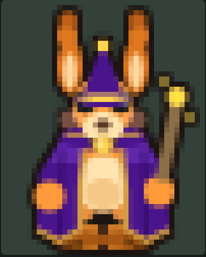

# A Roo, nosso mascote (arquivo histórico)

Registro do mascote como ele ficou no jogo, guardado para mostrar no futuro como o projeto foi feito.

## Quem é

Uma canguru alquimista de pelo laranja, orelhas altas com miolo claro, chapéu de bruxo e manto roxos com ferragens douradas, bolsa clara na barriga, olhos escuros com a faixa de sobrancelha. Pixel art indie no estilo Super Bomberman 3/5: escala inteira, contorno escuro de 1 px, sem degradês suaves.

## O que está aqui

| Arquivo | O que é |
|---|---|
| `roo-frente.png` | pose de frente (`roo_down_0`), ampliada 2x do catálogo |
| `roo-folha-de-poses.png` | todas as 31 poses do catálogo `/sprites.html`: andar (frente, costas, lado), dormir, mexer a poção, maestro, ler |
| `roo-bolha-fetal.gif`, `roo-bolha-observando.gif` | a Roo bebê na bolha iridescente (história, capítulo II) |
| `fonte/roo.ts` | o desenho da Roo em código (Phaser Graphics), sem imagem externa |
| `fonte/rooGeometry.ts`, `fonte/outline.ts` | medidas do sprite e contorno de 1 px |
| `fonte/rooBubble.ts` | a Roo bebê e a bolha, em canvas 2D |

## Como foi feita

- Nenhum arquivo de imagem: cada quadro é desenhado por código (elipses, triângulos, linhas) em 40x50 px e ampliado sem suavização.
- Paleta: pelo `#ff9a3a`, cabeça `#ffa448`, orelha `#e07820` com miolo `#ffd8a0`, focinho `#ffe4b0`, manto `#4a148c` (luz `#7e3fd0`, sombra `#2e0a5c`), ouro `#ffd54f` e `#d9a441`, olhos `#1a1a1a`, contorno `#1c1410`.
- Andar: 4 quadros por direção, o ciclo dura duas casas. Dormir: 2 quadros de respiração.
- A Roo bebê reaproveita a mesma paleta e as mesmas formas, com cabeça grande, corpo pequeno e chapéu e manto miúdos.

## Versão no git

Etiqueta `mascote-roo-v1` (ver abaixo): o código da Roo adulta exatamente como está nesta data (2026-11-12). Para voltar a ela: `git show mascote-roo-v1:src/textures/roo.ts`.

## Versões da Roo bebê na bolha (pose fetal)

- `versoes/fetal-lua-v2.gif` + `versoes/rooBubble-fetal-lua-v2.ts`: versão em lua crescente, sem chapéu (guardada em 2026-11-12).
- Versão atual (`roo-bolha-fetal.gif`): construída a partir da referência `referencia-bolha-fetal.png` (chapéu caído com estrela, orelha em pé, orelha deitada, mãozinhas no fecho dourado, manto de cobertor, bolhinhas ao redor).
